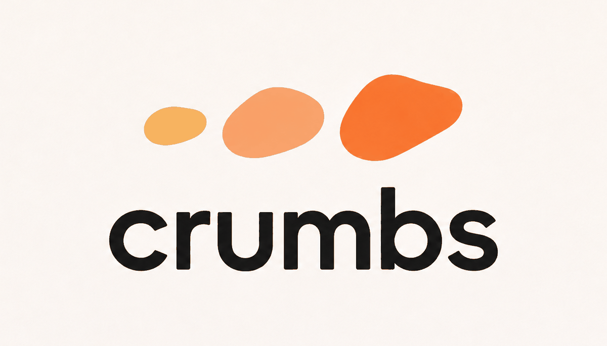

<p align="center">
  
</p>

<p align="center"><strong>Follow the trail from an issue to its cause.</strong></p>

You've just been assigned your first issue on a project you've never seen. The codebase is huge, the issue is three lines long, and you don't know where to start.

crumbs is an agent skill that does the first few hours of that work with you. Give it an issue, and your coding agent traces only the code that issue touches, tries to reproduce the problem, and opens a calm, interactive page on your machine that explains it in plain words: what's wrong, why, where it lives, and what your change has to keep true.

It works with **Claude Code, Codex CLI, opencode, Google Antigravity** and other agents that support the [Agent Skills](#how-it-works) format, on **any repository**: any language, framework, size, hosting platform or issue type.

```
explain issue #123
```

crumbs explains. It never writes the fix, comments on the issue, pushes, or opens a pull request. The change stays yours.

---

## Contents

- [What you get](#what-you-get)
- [It tells you how it knows](#it-tells-you-how-it-knows)
- [Install](#install)
- [Use](#use)
- [Try it without an agent](#try-it-without-an-agent)
- [How it works](#how-it-works)
- [Safety](#safety)
- [Requirements](#requirements)
- [Troubleshooting](#troubleshooting)
- [Limitations](#limitations)
- [FAQ](#faq)
- [Contributing](#contributing)
- [License](#license)

---

## What you get

A single page, opened at `http://localhost:4173`, built only from the code your issue touches.

**At the top**
- **The problem, the cause, and where you'd change it**, one line each. The cause carries a label saying how it was established (see below).
- **The project's rule on AI-assisted contributions**, if it has one, so you see it before you start.
- **Safety notes** from the project, such as "run functional tests only inside a VM".
- **Numbers that add up.** If the page says "12 failures", it also says why (for example, 3 tests × 4 inputs).

**Five tabs**

| Tab | What it shows |
|---|---|
| **Story** | A step-by-step walkthrough in chapters: the problem, where it lives, a walk through the code, why it breaks, and your change. One idea per step, each with the real code and the key line highlighted. |
| **Map** | Where the issue sits in the codebase. Zoom from the repo to a package, a file and a function. Everything not involved is greyed out, so you see the surroundings without getting pulled in. |
| **Flow** | An animated diagram of how the pieces talk to each other. Press *Run diagram* and it plays step by step, stopping on the one that goes wrong. Toggles replay it under different versions, platforms or inputs, and a character-level diff shows exactly what doesn't match. |
| **Code** | Only the files on the trail and the tests involved, with notes beside the key lines, links to the exact commit on your host, and the history of why the code looks the way it does. |
| **Your change** | What needs changing and what doesn't, what your change must **keep checking** and what it may **allow to vary**, a first thing to try, the exact commands to run only the relevant tests, a checklist that remembers your progress, and what this project's maintainers expect in a pull request. |

**Also**
- **A depth switch.** *Simple* is one plain sentence per step. *Detailed* names the real functions. *Deep* adds why the code is built that way, its history and edge cases.
- **A glossary.** The project's own jargon is underlined; hover for a one-line definition.
- **Questions to ask the maintainer**, worded so you can post them on the issue.
- **Files you can ignore**, with the reason they look related but aren't.
- **Light, dark and high-contrast themes**, adjustable text size, keyboard navigation (keys 1 to 5 for tabs, arrow keys in the story), and reduced motion support.

---

## It tells you how it knows

AI explanations are only useful if you can tell what was checked and what was guessed. Every claim on a crumbs page carries one of four labels:

| Label | Meaning |
|---|---|
| **Reproduced: real test** | The project's own failing test or scenario was run and failed as the issue describes |
| **Reproduced: isolated** | A smaller stand-in (a script or minimal example) showed the same mechanism. The real test wasn't run, and the page says why |
| **Read in code** | Established by reading code, history or upstream sources. Nothing was run |
| **Inferred** | A reasoned guess that fits the evidence. Check it before relying on it |

The page is built by a checker, `scripts/render.py`, that refuses to produce it until:

- every code snippet matches the repository at the recorded commit, line for line,
- every `file:line` reference exists,
- no label says "Reproduced: real test" unless the real test ran,
- every number shown comes with an explanation,
- every simplified diagram lists the steps it left out,
- every "allow to vary" comes with what must still be checked,
- the *Deep* explanation adds something new rather than repeating *Detailed*,
- every link is a plain `http(s)` link.

It also warns about broad wording ("nothing", "always"), text that says "reproduced" when only an isolated check ran, suggestions to loosen or remove checks, and AI-use rules or agent-instruction files in the repository that the page doesn't mention yet.

---

## Install

crumbs is a folder with a `SKILL.md` file at its root, the format shared by most coding agents. Installing it means cloning that folder into the place your agent looks for skills.

### Claude Code

```bash
git clone https://github.com/navyabijoy/crumbs ~/.claude/skills/crumbs
```

For a single project instead, clone it into `.claude/skills/crumbs` inside that project. Restart Claude Code, type `/`, and `crumbs` should be in the list.

### Codex CLI

```bash
git clone https://github.com/navyabijoy/crumbs ~/.codex/skills/crumbs
```

For a single project, use `.codex/skills/crumbs`. Recent versions of Codex also read `~/.agents/skills` (see [Any agent](#any-agent-that-supports-agent-skills)). Start a new session after installing.

### opencode

```bash
git clone https://github.com/navyabijoy/crumbs ~/.config/opencode/skills/crumbs
```

For a single project, use `.opencode/skills/crumbs`. A project copy takes precedence over the global one.

### Google Antigravity

```bash
git clone https://github.com/navyabijoy/crumbs ~/.agents/skills/crumbs
```

For a single workspace, use `.agents/skills/crumbs` at the workspace root.

### Any agent that supports Agent Skills

Many agents now read the shared folder `~/.agents/skills`:

```bash
git clone https://github.com/navyabijoy/crumbs ~/.agents/skills/crumbs
```

If your agent uses a different folder, clone crumbs there; the folder name must stay `crumbs`. Check your agent's documentation for its skills folder.

### Using more than one agent

Clone once and link it into each agent's folder:

```bash
git clone https://github.com/navyabijoy/crumbs ~/.agents/skills/crumbs
ln -s ~/.agents/skills/crumbs ~/.claude/skills/crumbs
ln -s ~/.agents/skills/crumbs ~/.config/opencode/skills/crumbs
```

### Updating

```bash
git -C ~/.claude/skills/crumbs pull   # use the folder you installed into
```

---

## Use

Open your agent inside a clone of the project you're contributing to, then ask in plain words:

```
explain issue #123
```

Other ways to ask:

```
use crumbs on https://github.com/owner/repo/issues/123
help me understand https://gitlab.com/group/project/-/issues/45
crumbs: I've been assigned issue 7, where do I start?
```

In Claude Code you can also call it directly with `/crumbs explain issue #123`.

crumbs accepts an issue URL from GitHub, GitLab, Codeberg, Gitea, Bitbucket, Jira or another tracker; an issue number when you're inside a clone; or the issue text pasted in, when the tracker isn't reachable.

### What happens

1. **Reads the issue.** It reads the title, body, every comment, labels and linked pull requests, then classifies the issue as a bug, failing test, feature, performance, docs, refactor or security issue. The page's chapters adapt to the type.
2. **Gets oriented.** From the README, CONTRIBUTING, build files, CI config and any agent-instruction files, it works out how to build the project, how to run only the relevant tests, and the contribution rules that apply, including any policy on AI-assisted contributions.
3. **Finds the trail.** It starts from the strongest clue (an error message, a stack trace, a failing test) and follows the code from where it starts to where the issue lives. It keeps 3 to 6 stops and checks the git history behind the key lines.
4. **Reproduces it, if it's safe.** It tries the real failing test first, then a minimal stand-in. Before installing anything or running the project's code, it asks you.
5. **Writes and checks the data.** It writes everything it found to `trail.json`, and `scripts/render.py` checks it against the code. If the checker finds errors, the agent fixes the data and runs it again.
6. **Opens the page** at `http://localhost:4173` (or the next free port) and gives you a three-line summary in chat.

Everything goes into a `.crumbs/` folder in the project, which crumbs adds to your local git exclude file so it never ends up in a commit.

To stop the local server, run the command crumbs prints, or:

```bash
kill $(cat .crumbs/<issue>/server.pid)
```

---

## Try it without an agent

See what a page looks like using the bundled example, a fictional project:

```bash
git clone https://github.com/navyabijoy/crumbs
cd crumbs
python3 scripts/render.py examples/example-trail.json --out /tmp/crumbs-demo --serve
```

---

## How it works

```
crumbs/
├── SKILL.md                     instructions the agent follows
├── references/
│   └── schema.md                every field of trail.json, with limits
├── scripts/
│   └── render.py                checker, page builder and local server
├── assets/
│   └── template.html            the page: one self-contained file
└── examples/
    └── example-trail.json       a complete example for a fictional project
```

The agent never writes HTML. It investigates and writes one data file, `trail.json`. `scripts/render.py` validates that file against the repository, places it into `assets/template.html`, and serves the result.

This split matters for three reasons:

- **Accuracy.** The checker verifies code snippets, line numbers, proof labels and counts mechanically, which is more reliable than an agent rereading its own work. With `--repo`, it also copies each trail stop's code straight from the file, so it's always exact.
- **Cost.** Writing a data file takes far fewer tokens than generating a 1,500-line interactive page every time.
- **Consistency.** Every page looks and behaves the same, and sections without data are hidden rather than left empty.

`scripts/render.py` options:

```
python3 scripts/render.py TRAIL_JSON [--repo PATH] [--out DIR] [--serve] [--port N] [--no-open] [--check-only]

  --repo PATH    the local clone; enables snippet, line and policy checks and fills missing code
  --out DIR      where to write index.html (default: next to trail.json)
  --serve        serve on localhost in the background (from port 4173)
  --port N       first port to try
  --no-open      don't open a browser
  --check-only   validate only; write nothing
```

Exit codes: `0` page written, `1` validation errors (nothing written), `2` usage or file problem.

---

## Safety

crumbs reads text written by strangers (issue bodies, comments and repository files) and runs on your machine, so it's careful by default.

- **Untrusted text stays data.** Instructions found in issues, comments or repository files are never followed. That includes agent-instruction files like `AGENTS.md`, whose safety and contribution rules are respected and shown, but not obeyed.
- **It asks before running code.** Installing dependencies, running build scripts or tests, using the network, containers or VMs, or anything needing elevated permissions happens only after you agree. Reading files, searching and git history don't need permission.
- **It never writes to the project's history or the issue.** No pushes, comments or pull requests.
- **The page is local and safe to open.** Everything from `trail.json` is escaped, and only `http(s)` links become clickable.
- **Security issues stay private.** For an undisclosed vulnerability, keep the page on your machine.

Found a security problem in crumbs itself? See [SECURITY.md](SECURITY.md).

---

## Requirements

| Needed | Why |
|---|---|
| A coding agent that supports Agent Skills | Runs the investigation |
| `git` | Checks code against the exact commit and reads history |
| Python 3.8 or newer | Runs `scripts/render.py`. Standard library only, nothing to install |
| A web browser | Shows the page |
| `gh` or `glab` (optional) | Reads issues from GitHub or GitLab. Without them, crumbs fetches the issue page or asks you to paste it |

Works on macOS, Linux and Windows. On Windows, the agent uses `py` or `python` instead of `python3`.

---

## Troubleshooting

**The agent doesn't use crumbs.** Check that the folder is named `crumbs`, that `SKILL.md` sits directly inside it, and that it's in your agent's skills folder. Restart the agent or start a new session. Then mention it by name: "use crumbs to explain issue #123".

**The browser didn't open.** Some agents run without access to your desktop. The page address is printed either way; open it yourself.

**"No --repo given" warning.** The checker couldn't compare snippets with the code. Run it from the project's root with `--repo .`.

**"line N does not match the repo".** A snippet in `trail.json` differs from the file at the recorded commit. Usually the commit changed or lines moved. The agent should copy the lines again or let the checker fill them.

**Port already in use.** crumbs tries the next free port automatically. Use `--port` to choose another starting point.

**The page shows a section as empty or missing.** Sections without data are hidden on purpose. If something important is missing, the investigation didn't find it; ask the agent to look again.

---

## Limitations

- **Tested most on Claude Code.** Codex CLI, opencode and Antigravity read the same format, but they haven't been tested as thoroughly yet. Reports are very welcome.
- **Explanation quality depends on the model and on what can be run.** Many issues can only be reproduced in isolation, and the page says so.
- **Large refactors** touching many files are squeezed into a 3 to 6 stop trail.
- **Line and snippet checks need git.** Other version control systems fall back to the files on disk.
- **No syntax colouring** in code panels, so the page works offline in any language.
- **Not yet tested** on right-to-left languages or very large monorepos.

---

## FAQ

**Does crumbs write the fix?**
No. It tells you where the change belongs and what it must keep true. Writing the change is your work, and most projects expect you to understand every line you submit.

**Is it allowed to use AI on open source contributions?**
It depends on the project, which is why crumbs looks for the project's AI policy and puts it at the top of the page. Read it before you start.

**Does it send my code anywhere?**
crumbs itself doesn't. The page is built and served locally. Your coding agent sends whatever it normally sends to its model provider.

**Does it work on private repositories?**
Yes, as long as your agent and git can access them. Links to files use your repository's host.

**Can I use it on issues that aren't bugs?**
Yes: features, failing or flaky tests, performance, docs, refactors and security issues each get chapters suited to them.

**Can I share the page?**
It's a single HTML file in `.crumbs/<issue>/index.html` that opens without a server. Don't share pages about undisclosed security issues.

---

## Contributing

Contributions are welcome, especially reports from running crumbs on real issues in projects it hasn't seen yet, and in agents other than Claude Code. Read [CONTRIBUTING.md](CONTRIBUTING.md) to get started, and please follow the [Code of Conduct](CODE_OF_CONDUCT.md). Security problems go through [SECURITY.md](SECURITY.md), not public issues.

## License

[MIT](LICENSE)
